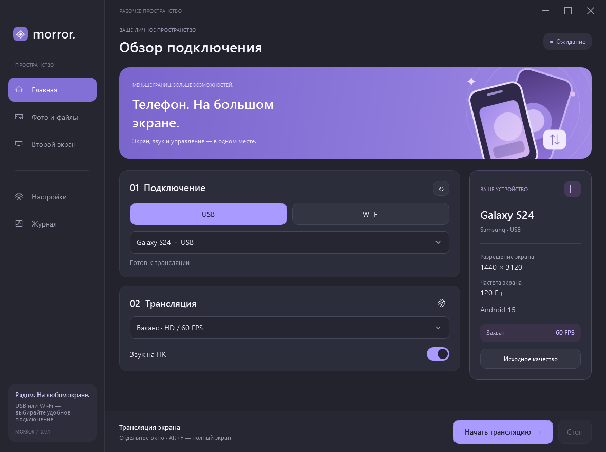
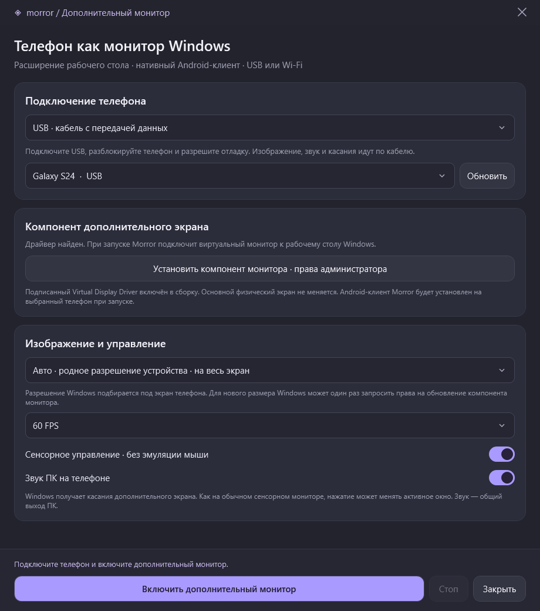
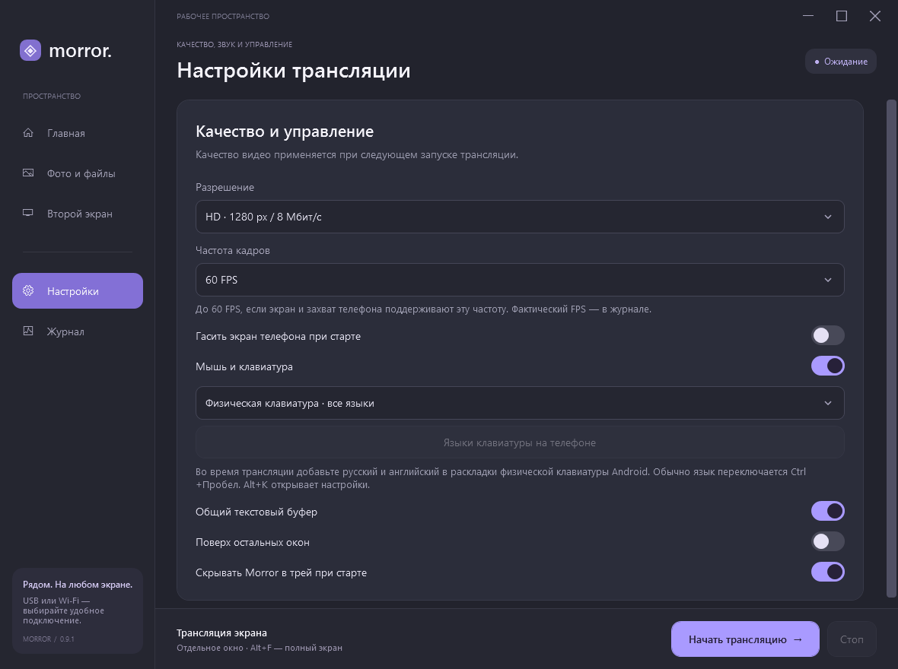
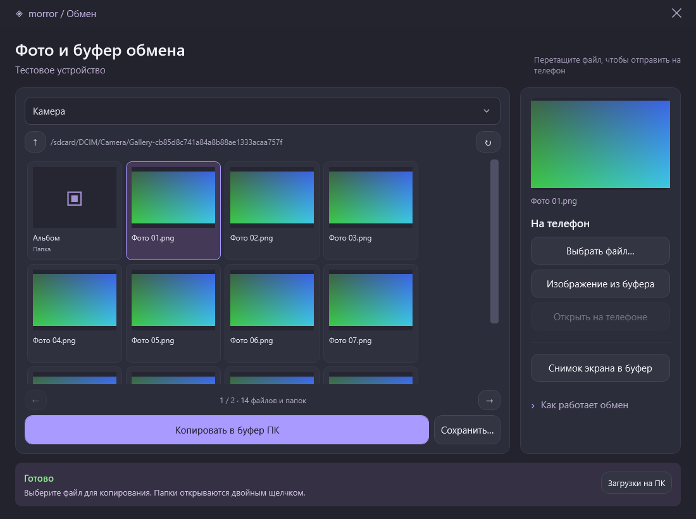
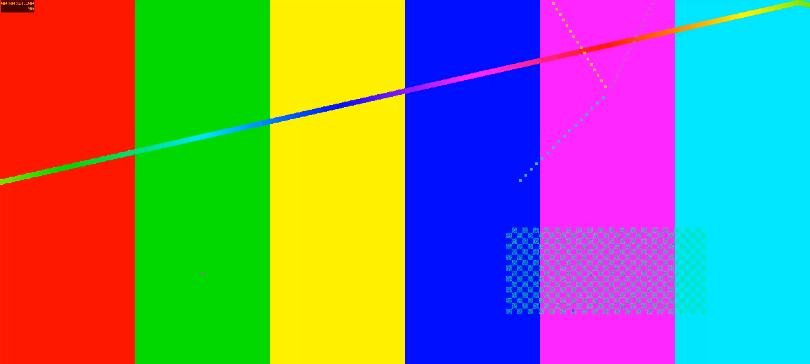

# Morror

**Mirror Android on Windows, or turn an Android device into a native Windows second monitor — over USB or Wi-Fi.**

Morror combines a Russian-language WPF desktop interface, the official [scrcpy 5.0.1](https://github.com/Genymobile/scrcpy/tree/v5.0.1) runtime for Android-to-PC mirroring, and a native Android receiver for PC-to-Android display extension.

**Latest release: 0.9.1.** The installer and portable ZIP include Android mirroring, the native second-monitor receiver, encoder and signed virtual display component.

[Published releases](https://github.com/Lisichkinoff/Morror/releases) · [Download 0.9.1 installer](https://github.com/Lisichkinoff/Morror/releases/download/v0.9.1/Morror-0.9.1-Setup-win64.exe) · [Download 0.9.1 portable ZIP](https://github.com/Lisichkinoff/Morror/releases/download/v0.9.1/Morror-0.9.1-win64.zip) · [Second-monitor guide](docs/second-screen.md)

## Features

| Android → Windows | Windows → Android |
| --- | --- |
| Screen, audio, mouse and keyboard control through scrcpy | A real extended Windows desktop through a signed virtual display driver |
| USB, Wi-Fi QR pairing and USB-to-Wi-Fi migration | USB or the same Android wireless-debugging QR pairing |
| Quality presets, native resolution and configurable FPS limits | Native Android MediaCodec receiver; no browser or WebView |
| Physical UHID keyboard with multilingual layouts | Automatic device-native resolution and aspect-preserving HD/FHD modes |
| Gallery, thumbnails, file transfer and clipboard actions | Multitouch input with a filter for touch-generated mouse movement |
| Tray controls, live pinning and connection logs | System audio through WASAPI loopback and Android AudioTrack |

The desktop UI currently uses Russian labels. Mirroring, file transfer and second-monitor controls are available from the sidebar.

## Screenshots

Fresh screenshots of the current 0.9.1 interface. Desktop screenshots use a simulated device and generated images, without personal files or clipboard contents.

### Connection dashboard



### Native second-monitor setup

Device-native resolution is selected by default. The included display component is installed once, and Morror installs its Android receiver on the selected authorized device.



### Mirroring settings



### Files and clipboard



### Android receiver

A real Pixel 8 displaying a **synthetic test pattern at 2400 × 1080**, with the image reaching both screen edges. This demonstrates the native receiver and aspect ratio, not a Windows desktop screenshot or a performance benchmark.



## Requirements and installation

- **Windows:** Windows 10 version 1809 or later / Windows 11, x64, .NET Framework 4.8.
- **Android mirroring:** an authorized USB or wireless ADB connection. Android audio forwarding requires Android 11 or later; unlock Android 11 before starting.
- **Second monitor:** Android 8.0 or later, Android H.264 decoding, Windows Media Foundation, and the included signed Virtual Display Driver.
- **QR pairing:** Android 11 or later with Wireless debugging enabled.

The Windows installer runs per user. Installing the virtual display component, or registering a previously unsupported monitor resolution, requires Windows administrator approval. Root access on Android is not required.

Run `dist/Morror-0.9.1/Morror.exe`, install `dist/Morror-0.9.1-Setup-win64.exe`, or extract the entire `dist/Morror-0.9.1-win64.zip`. Keep the runtime, QRCoder library and license files together. Exit an older running instance from its tray menu before updating.

## Mirror Android on your PC

### USB

Enable **Developer options → USB debugging**, connect a data-capable cable, unlock the phone and authorize the PC. Select the device and start mirroring.

### Wi-Fi with a QR code

1. Put the PC and Android device on the same local network. The PC may use Ethernet.
2. In Morror, select Wi-Fi and **«Подключить по QR-коду»** (Connect by QR code).
3. On Android, open **Developer options → Wireless debugging → Pair device with QR code**.
4. Scan using Android's wireless-debugging scanner, finish pairing and start mirroring.

For manual pairing, use the IP address, pairing port and six-digit code from Android's pairing dialog. The connection port shown on the main Wireless debugging screen is a different port. If mDNS discovery is unavailable, enter that connection address after pairing; the pairing itself remains saved. IPv4 and bracketed IPv6 addresses are supported.

For older devices, connect and authorize USB first, then use **USB → Wi-Fi** in Morror. This enables legacy ADB TCP/IP on port 5555 until the phone restarts. Use a trusted network. Morror does not modify your router or firewall, and does not restart the shared ADB server.

### Quality, keyboard and tray controls

| Preset | Long edge | Capture limit | Video bitrate |
| --- | --- | --- | --- |
| Balanced, default | 1280 px | 60 FPS | 8 Mbps |
| Lower load | 720 px | 30 FPS | 4 Mbps |
| Sharp | 1920 px | 60 FPS | 16 Mbps |

Settings also expose 2K, QHD, 4K, original resolution, higher FPS limits and an uncapped mode. Actual frame rate depends on the device, encoder and connection. Higher limits increase load; a configured limit is not a measured performance claim. Settings apply on the next mirroring session.

The default `--keyboard=uhid` mode supports physical-keyboard layouts, including Russian and English. During mirroring, press **Alt+K** to configure Android's physical keyboard. Language switching is usually **Ctrl+Space**; Android layouts are independent of Windows layouts. A compatible SDK keyboard mode is available for devices that cannot use UHID.

Morror can hide to the tray after the mirror opens. Double-click its tray icon to restore settings; stopping or losing the stream restores them automatically. Pinning the mirror can be changed during playback. If phone-screen power saving is enabled, **Alt+Shift+O** turns the Android screen back on.

## Use Android as a second monitor

1. Open **«Второй экран»** (Second screen) in the sidebar.
2. Install the included display component once and approve the Windows prompt.
3. Connect by USB or QR-paired Wi-Fi and select the authorized device.
4. Keep **Auto · device-native resolution** selected and enable the monitor.
5. Morror installs and starts its native Android receiver. Move Windows applications onto the new extended display.

No desktop browser, screen-sharing picker or Android WebView is used. The same bounded, authenticated TCP protocol runs through a session-owned ADB reverse tunnel for both USB and Wi-Fi.

### Full-screen resolution

Auto mode uses the effective Android panel dimensions in landscape orientation. For a Pixel 8, Windows and the video stream use **2400 × 1080**, rather than forcing a 16:9 desktop into a wider phone screen.

| Mode on a Pixel 8 | Windows monitor and video size |
| --- | --- |
| Auto / native | 2400 × 1080 |
| Full HD budget | 1920 × 864 |
| HD budget | 1280 × 576 |

A new size is added to the driver's configuration with a backup, preserving existing modes, GPU options and monitor counts. Windows may request administrator approval the first time; the virtual driver is refreshed without restarting physical graphics adapters.

### Touch and current limitations

Touch events are delivered to the virtual monitor through Windows touch APIs. Morror filters mouse-movement messages promoted from its touch input, while allowing ordinary physical mouse movement. Touch can still activate another Windows window and change keyboard focus, as on a normal touchscreen. This is not a separate Windows user session.

The current receiver uses landscape orientation. Pen pressure, tilt, palm rejection and automatic monitor rotation are not implemented. Protected video, elevated windows and applications with specialized input can have limitations. System audio is the PC's shared output mix, not per-window audio. Encoder selection prefers NVENC or hardware Media Foundation and falls back to software Media Foundation; actual latency and FPS depend on the PC.

See the [full second-monitor guide](docs/second-screen.md) for lifecycle details and the hardware-validation status.

## Files and clipboard

The gallery lists shared Android storage with paginated thumbnails. It can download originals, copy supported images or files into the Windows clipboard, upload selected files or clipboard images, and open a transferred file after Android media indexing succeeds. Pictures go to `Pictures/Morror`; other files go to `Download/Morror`. Source files are not deleted.

Text clipboard synchronization is available during mirroring. Android image/URI clipboard data is not synchronized automatically, and uploading a picture does not paste it into an Android message. Private application storage and cloud-only files are outside the gallery's scope. The system clipboard is read for upload only after a user action.

## Build from source

Run in PowerShell from the repository root:

```powershell
./scripts/get-scrcpy.ps1
./scripts/get-qr-dependencies.ps1 -IncludeTests
./scripts/get-native-monitor-dependencies.ps1 -BuildTools
./scripts/build-android-monitor.ps1
./build.ps1 -Test
./scripts/test-second-screen.ps1
./scripts/get-installer-tools.ps1
./scripts/build-installer.ps1 -SkipBuild -Test
```

The desktop build uses the .NET Framework C# compiler; a separate .NET SDK is not required. Android builds use a pinned JDK and Android SDK without Gradle. Dependency archives are pinned by version and SHA-256. Toolchains and downloaded archives stay in ignored directories. The APK signing key is created locally under `tools/native-monitor`; preserve it for compatible APK updates and do not commit it.

Outputs go to `dist/Morror-0.9.1`. `build.ps1` accepts `-OutputDirectory`. The Android APK, native encoder, signed driver package and licenses are included in the Windows payload.

## Validation

Automated checks cover ADB arguments and timeouts, pairing and device selection, connection migration, gallery/file-transfer limits, clipboard payloads, tray/window behavior, native H.264 packet boundaries, authenticated monitor sessions, resolution calculations and configuration backups. UI screenshots use test fixtures. Installer tests use isolated destinations and preserve unrelated files.

Hardware checks on a Pixel 8 over Wi-Fi verified the native Android decoder, 2400 × 1080 full-screen output and returning touch events. The installed Windows virtual monitor was switched to 2400 × 1080 at 60 Hz while preserving physical monitor dimensions, positions and primary selection. These checks do not establish universal device compatibility, sustained FPS, latency or USB-cable performance; see the guide for remaining validation.

## Credits and licenses

Android-to-PC capture and control are provided by **scrcpy**, developed by **Genymobile** and **[Romain Vimont (rom1v)](https://github.com/rom1v)**. Morror is an independent project, not an official Genymobile or scrcpy product. The official scrcpy binaries are distributed without modification.

```text
Copyright (C) 2018 Genymobile
Copyright (C) 2018-2026 Romain Vimont
```

scrcpy uses the Apache License 2.0. Its [license](licenses/scrcpy-LICENSE.txt) is preserved in this repository and in the runtime. Native second-monitor support uses the MIT-licensed Virtual Display Driver and a separate LGPL FFmpeg executable. QRCoder is MIT-licensed. See [THIRD-PARTY-NOTICES.md](THIRD-PARTY-NOTICES.md) and the bundled licenses for attribution, exact versions, hashes and source links.
