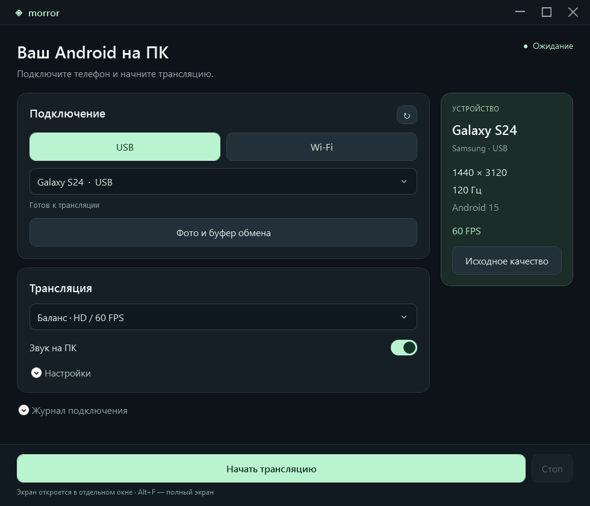
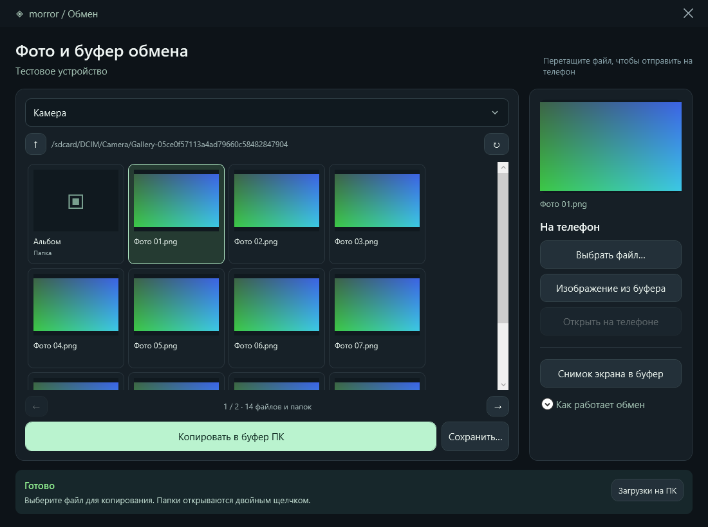

# Morror 0.9.0

Windows-приложение для экрана, звука и управления Android через USB или Wi-Fi. Интерфейс WPF на русском, движок — scrcpy 5.0.1. Нужны Windows 10 (1809+) / Windows 11 x64 и .NET Framework 4.8.

**Скачать:** [установщик Windows x64](https://github.com/Lisichkinoff/Morror/releases/latest/download/Morror-0.9.0-Setup-win64.exe) · [переносимый ZIP](https://github.com/Lisichkinoff/Morror/releases/latest/download/Morror-0.9.0-win64.zip) · [все релизы](https://github.com/Lisichkinoff/Morror/releases).

## Основано на scrcpy

Morror — самостоятельная Windows-оболочка для **[scrcpy 5.0.1](https://github.com/Genymobile/scrcpy/tree/v5.0.1)**. Захват экрана и звука, трансляцию и управление Android выполняет scrcpy. Morror добавляет русский интерфейс, настройку подключения и качества, трей, галерею и передачу файлов через ADB. Официальные бинарные файлы scrcpy используются без изменений.

Авторы scrcpy — **Genymobile** и **[Romain Vimont (rom1v)](https://github.com/rom1v)**. Уведомления об авторских правах из поставляемой лицензии:

    Copyright (C) 2018 Genymobile
    Copyright (C) 2018-2026 Romain Vimont

scrcpy распространяется под **Apache License 2.0**. [Полный текст лицензии scrcpy](licenses/scrcpy-LICENSE.txt) сохранён в репозитории и включён в сборки как `runtime/LICENSE.txt`. Условия остальных компонентов перечислены в [THIRD-PARTY-NOTICES.md](THIRD-PARTY-NOTICES.md).

Morror — отдельный проект, не официальный продукт Genymobile или авторов scrcpy. Благодарим разработчиков scrcpy за движок трансляции.

## Интерфейс

Главное окно:

Галерея и буфер обмена (демонстрационные изображения):

## Запуск и установка

- Установщик: dist/Morror-0.9.0-Setup-win64.exe. Установка для текущего пользователя без прав администратора. Можно выбрать папку и ярлык на рабочем столе.
- Переносимая версия: dist/Morror-0.9.0/Morror.exe или архив dist/Morror-0.9.0-win64.zip. Переносите всю папку вместе с runtime, QRCoder.dll и лицензиями.
- Перед запуском новой версии завершите старую через меню трея «Выйти из Morror».

Установщик и удаление сохраняют посторонние файлы и общие ключи ADB. Значок приложения находится в трее рядом с часами; двойной щелчок возвращает окно.

## Что изменилось

Главный экран стал компактнее: подключение, режим трансляции и запуск. Подробные параметры находятся в «Настройки», инструкции — в раскрывающихся блоках и подсказках. Кнопки запуска и остановки всегда доступны внизу.

Добавлены автоподключение после ручного сопряжения, проверка готовности ADB, переход с USB на Wi-Fi, адреса IPv6 в квадратных скобках, галерея с миниатюрами и физическая клавиатура UHID.

## Подключение

### USB

Включите «Для разработчиков → Отладка по USB» на телефоне. Подключите кабель с передачей данных, разблокируйте телефон и подтвердите доступ для ПК. Выберите устройство и начните трансляцию.

### Wi-Fi на Android 11+

Телефон и ПК должны быть в одной сети; ПК может подключаться к роутеру кабелем.

1. В Morror выберите Wi-Fi → «Подключить по QR-коду».
2. На телефоне: «Для разработчиков → Беспроводная отладка → Подключить устройство с помощью QR-кода».
3. Используйте сканер беспроводной отладки. После подключения нажмите «Готово» и начните трансляцию.

Если QR не срабатывает, откройте «Код или IP-адрес». Возьмите IP:порт и 6 цифр из окна сопряжения на телефоне. Morror выполняет сопряжение и до 25 секунд ищет порт подключения именно этого телефона. Если mDNS недоступен, сопряжение сохраняется: введите IP:порт с главной страницы беспроводной отладки и нажмите «Подключить по адресу». Это другой порт, код повторно не нужен.

Поддерживаются IPv4 и IPv6 вида [2001:db8::20]:37123. При смене сети или перезапуске беспроводной отладки порт может измениться. Включённой USB-отладки недостаточно для TLS-сопряжения.

### Переход с USB на Wi-Fi

Подходит и для телефонов без меню беспроводного сопряжения.

1. Подключите и авторизуйте телефон по USB. Подключите его к Wi-Fi той же сети, что и ПК.
2. Выберите этот USB-телефон в списке и нажмите Wi-Fi → «Перейти с USB на Wi-Fi».
3. Дождитесь сообщения «USB можно отключить». Morror выберет проверенное беспроводное подключение.

Команда включает обычный ADB TCP/IP на порту 5555 до перезагрузки телефона. Используйте доверенную сеть. Для возврата только к USB можно перезагрузить телефон. Некоторые производители запрещают этот режим.

Список показывает все найденные устройства, отдавая приоритет выбранному типу подключения. USB-телефон остаётся доступен для перехода на Wi-Fi. Гостевые сети с изоляцией, VPN и запрет mDNS могут мешать подключению; Morror не меняет брандмауэр или настройки роутера. Перезапуск общего сервера ADB не выполняется.

## Качество и нагрев

| Режим | Длинная сторона | FPS | Битрейт |
| --- | --- | --- | --- |
| Баланс, по умолчанию | 1280 px | до 60 | 8 Мбит/с |
| Меньше нагрев | 720 px | до 30 | 4 Мбит/с |
| Чётко | 1920 px | до 60 | 16 Мбит/с |

В «Настройки» доступны 2K, QHD, 4K, исходное разрешение и лимиты до 240 FPS или без ограничения. Ручное изменение разрешения/FPS переключает режим на «Свои настройки». Кнопка «Исходное качество» снимает ограничения разрешения/FPS; она увеличивает нагрузку по сравнению с балансом.

Для снижения нагрузки выберите «Меньше нагрев». Дополнительно можно включить «Гасить экран телефона при старте»: трансляция продолжается, экран включается обратно Alt+Shift+O в окне телефона. Это требует включённого управления. В скрытом окне настроек во время трансляции не опрашивается список ADB каждые 5 секунд.

Нагрев зависит от телефона, приложений, сети, зарядки и кодировщика. Снижение температуры на физическом устройстве в 0.9.0 не измерялось. Частота панели и FPS захвата различаются; фактический FPS доступен в журнале. Изменения качества применяются при следующем запуске трансляции.

## Клавиатура и языки

По умолчанию используется --keyboard=uhid: Android получает физическую клавиатуру, поддерживающую русский и другие языки по USB и Wi-Fi.

Один раз во время трансляции нажмите Alt+K в окне телефона или откройте Morror → «Настройки → Языки клавиатуры на телефоне». Выберите клавиатуру scrcpy и добавьте русскую и английскую раскладки. Для переключения обычно используется Ctrl+Пробел; точное сочетание зависит от Android и установленного метода ввода.

Раскладки Android настраиваются отдельно от Windows. Win+Пробел переключает раскладку Windows и не означает переключение языка телефона.

Для старых устройств без UHID остановите трансляцию и выберите «Совместимость · SDK». В этом режиме ввод кириллицы ограничен; русский текст можно вставлять через общий буфер. Основание: [документация scrcpy о клавиатуре](https://github.com/Genymobile/scrcpy/blob/v5.0.1/doc/keyboard.md).

## Фото и буфер обмена

Откройте «Фото и буфер обмена» под списком устройств или через меню трея. Трансляцию запускать необязательно.

- Файлы телефона показаны плитками по 12 на страницу. Папки открываются двойным щелчком, стрелки перелистывают страницы. Выбор картинки показывает превью справа.
- Превью загружаются последовательно только для текущей страницы: до 8 МиБ на файл и 24 МиБ на страницу, с тайм-аутом 8 секунд на файл. На ПК декодируются миниатюры до 320 px, временные копии удаляются. Переход в другую папку, перелистывание, передача файла и закрытие окна отменяют текущую загрузку.
- Для превью требуется кратковременная загрузка оригинала. HEIC, AVIF и другие форматы без Windows-кодека, а также большие файлы доступны без миниатюр. Ошибка превью не запрещает копирование оригинала.
- «Копировать в буфер ПК» копирует оригинал: для поддерживаемых изображений в буфере доступны Bitmap, PNG и файл. Нажмите Ctrl+V в нужном приложении Windows.
- «Сохранить…» сохраняет оригинал в выбранную папку. Для буфера копии остаются в «Загрузки/Morror», чтобы вставка работала после закрытия Morror.
- «Снимок экрана в буфер» копирует видимый экран телефона, а не оригинал фотографии.
- «Выбрать файл…», «Изображение из буфера» и перетаскивание отправляют файл на телефон. Фото сохраняются в Pictures/Morror, остальные файлы — в Download/Morror. Размер проверяется, запрашивается индексация в медиатеке.
- После подтверждения индексации доступно «Открыть на телефоне». Отправленный файл можно прикрепить в приложении Android; отправка сама по себе не вставляет изображение в буфер Android.

Общий Ctrl+C / Ctrl+V в трансляции передаёт текст. Картинки и URI из буфера Android автоматически не синхронизируются. Доступна общая память телефона, без приватных файлов приложений и облачных фото, не загруженных на устройство. Оригиналы не удаляются. Системный буфер Windows читается для отправки только после нажатия кнопки.

## Трансляция и трей

По умолчанию после открытия окна телефона Morror скрывается в трей. Двойной щелчок по значку возвращает настройки. В меню доступны обмен файлами, закрепление окна, остановка и выход. Закрытие настроек во время трансляции сохраняет её; остановка или обрыв возвращает окно настроек. Переключатель «Скрывать Morror в трей при старте» отключает автоматическое скрытие.

Звук поддерживается на Android 11+, на Android 11 телефон при старте должен быть разблокирован. Дополнительные разрешения управления могут зависеть от производителя.

## Сборка и проверка

В PowerShell:

    ./scripts/get-scrcpy.ps1
    ./scripts/get-qr-dependencies.ps1 -IncludeTests
    ./build.ps1 -Test
    ./scripts/get-installer-tools.ps1
    ./scripts/build-installer.ps1 -SkipBuild -Test

Сборка использует C#-компилятор .NET Framework, без отдельного SDK. Загрузки закреплены версиями и SHA-256. Результат находится в dist/Morror-0.9.0; build.ps1 принимает -OutputDirectory.

Проверки покрывают команды и параметры трансляции, адреса, mDNS, сопряжение, переход с USB на Wi-Fi, состояния доступа, буфер, передачу файлов, лимиты превью, галерею, выбор режимов, окна и трей. UI проверяется с тестовым ADB/scrcpy и синтетическими изображениями; системный буфер пользователя не меняется. QR декодируется независимым ZXing. Скриншоты окон сохраняются в test-output.

Установщик проверяется в отдельной тестовой папке без рабочих ярлыков и записи удаления: установка с ярлыком и без него, контроль файлов, повторная установка и удаление с сохранением постороннего файла.

Для 0.9.0 физическое устройство во время разработки не подключено: реальные Wi-Fi-сопряжение, переключение языков и температура требуют проверки на телефоне. В 0.8.1 ранее проверялся файловый обмен тестовым PNG с Pixel 8 по Wi-Fi. tests/DeviceTransferSmoke.cs позволяет отдельно проверить передачу собственного тестового файла на авторизованное устройство.
